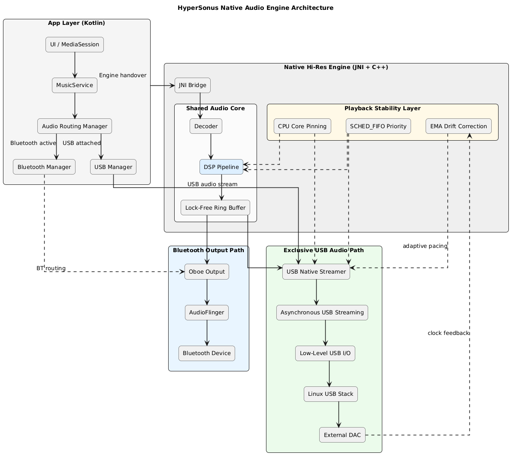

# HyperSonus: Hi-Res Bit-Perfect Spatial Audio Player
- Native Android Bit-Perfect Audio Player
- Uses C++ Decoding and Custom USB streaming engine for USB DAC output. 



# C++ Audio Engine
**File resolution**: get the File Descriptor, map to respective format .flac, .wav, .dsd, .dsf

**C++ Audio Engine** : parse the file, send the file to respective decoder(IDecoder interface) and send frames to Oboe, UsbNativeStreamer, Direct AudioTrack (Java) ──> BT A2DP Stack

- Audio Engine is completely built using C++ transitioned from using FFmpeg to handling decoders entirely in the application.
- Has Decoders for DSD (DSF/DFF), FLAC, WAV, AIFF, Opus (OGG/WebM), Vorbis, AAC/M4A, ALAC, MP3, APE (Monkey's Audio)
- DecoderFactory Triggers the appropriate decoder for the given audio format.
- Uses SoxrResampler (LibSoxr) resampling for DSD DoP to PCM conversion and shibata Dither
- Biquad.h is implementation of standard biquad (bi-quadratic) digital IIR filter and a cascaded 4th-Order Butterworth Low-Pass Filter (ButterworthLP4).
  used for Ultrasonic Noise Filtering during DSD-to-PCM Decimation
- DSD (Direct Stream Digital / 1-bit Sigma-Delta modulation) inherently pushes high-frequency quantization noise into the ultrasonic spectrum above audible frequencies (typically starting around 20–30 kHz).
- DspPipeline controls Equalizer, Gain, Dither, Normalizer, Limiter, FftAnalyzer, Resonance, UltraSpatial, Vibrancy,  DCBlock, PreAmp, PostAmp, Gain, Dither, Normalizer, Limiter, FftAnalyzer, Resonance, UltraSpatial, Vibrancy and Reverb nodes in 64 bit float path.

---

## Audio Routing : AudioOutputFactory

AudioOutputFactory has Classification of devices: USB_DAC, BLUETOOTH, Speaker and responsible for createOutput based on deviceClass

DacHelper identifies the current output device ie bluetoothDevice, usbDevice, internalDevice and returns their frequency response probedSampleRates.

BaseAudioOutput is an abstraction of where each output type utilizes the methods and overrides based on the requirement.
- MediaPlayerOutput
- NativeHiResOutput
- DirectAudioOutput
- UsbDirectOutput
- HSHardwareOutput
---

## Audio Output : AudioOutputFactory linked to MusicService

SettingsActivity has option onOpenAudioPath

1. **NativeHiResOutput (OboeAudioSink)**
```text
C++ Engine (Decode + DSP) ──> OboeAudioSink ──> Oboe C++ ──> AAudio / OpenSL ES (Kernel/HAL)
```

2. **DirectAudioOutput (JniAudioSink) — ROM-Bypass Bluetooth**
```text
C++ Engine (Decode + DSP) ──> JniAudioSink ──> JNI Call ──> DirectAudioOutput (Java) ──> BT A2DP Stack
```

3. **UsbDirectOutput — USB Audio**
```text
C++ Engine -> USB Native Streamer (Ring Buffer SPSC with EMA tuned with 12.000ufs stable feeds to DAC) -> USB_DAC
```

4. **MediaPlayerOutput — Speaker**
```text
C++ Engine -> OboeAudioSink -> AudioFlinger -> Speaker
```

---

## App Audio Playback & Output Architecture

- has interface IAudioOutput that has methods of play, pause etc
- BaseAudioOutput abstract class implementing standard listener and state-handling logic 
- MediaPlayerOutput is the general android player that is generally used in many devices flows via AudioFlinger.
- UsbDirectOutput is the corresponding layer to C++ UsbNativeStreamer player that plays audio from USB.
- NativeHiResOutput plays audio from Bluetooth.

---

## Service Architecture: ServiceSubsystemRegistry & Managers

Deconstructs `MusicService` from a monolithic service into modular, single-responsibility managers coordinated via a composition root.

```text
UI / MediaController / System
         │
         ▼
    MusicService (Lifecycle, Foreground, MediaSession Orchestrator)
         │
         ▼
 ServiceSubsystemRegistry (Composition Root & Dependency Container)
 ┌───────────────┬─────────────────┬──────────────────┐
 │               │                 │                  │
 ▼               ▼                 ▼                  ▼
PlaybackEngine-  QueueManager      VolumeManager      AudioRoutingManager
Controller       (Tracks/Shuffle/  (Remote Vol /      (Device changes /
(Engine life,    Repeat / Queue)   Attenuation)       Output switching)
Play/Pause/Seek)
 │               │                 │                  │
 ▼               ▼                 ▼                  ▼
GaplessManager   UsbPlayback-      Notification-      SystemEventManager
(Pre-buffering / Manager           Bridge             (Noisy audio,
Crossfade)       (Bit-perfect DAC) (Media Controls)   Headset plug, Phone)
```

- **MusicService**: Slim orchestrator managing Android Service lifecycle, MediaBrowser/MediaSession callbacks, and foreground service notification dispatch.
- **ServiceSubsystemRegistry**: Composition root created in `MusicService.onCreate()`. Lazily instantiates all domain managers and exposes `wireListeners()` to bind callbacks, bridges, and coroutine collectors in deterministic initialization order.
- **Dedicated Subsystem Managers**:
  - `PlaybackEngineController`: Controls playback state machine, track loading, seeking, and C++ engine lifecycle.
  - `QueueManager`: Manages playlist queue, track indexing, shuffle/repeat modes, and persistence.
  - `VolumeManager`: Coordinates hardware volume keys, software gain/attenuation, and `VolumeProviderCompat`.
  - `AudioRoutingManager`: Monitors device connection changes (Bluetooth, USB DAC, Internal Speaker) and triggers output factory re-routing.
  - `GaplessManager`: Manages track look-ahead, background pre-buffering, and seamless crossfade transitions.
  - `UsbPlaybackManager`: Manages USB DAC attachment, Android USB permission intents, and bit-perfect streaming.
  - `NotificationBridge`: Maps playback state and album artwork into Android MediaStyle notifications.
  - `SystemEventManager`: Handles system broadcast receivers (headset disconnect `ACTION_AUDIO_BECOMING_NOISY`, phone call audio focus).
- **Communication & Decoupling**: Managers communicate using lightweight, focused interfaces (`PlaybackCommands`, `PlaybackStateAccessor`, `EngineHolder`, `VolumeSyncer`) and Kotlin coroutines/`SharedFlow` events, completely preventing circular dependencies and class-initialization race conditions.

---

## AI Music Recommendation system

- RmsAnalyzer does VRMS parsing of audio tracks and save values in Room DB SQL DB limit 50.
- SimilarityEngine uses cosine similarity beetween the songs to detect top n audio files.
- MoodMixProvider uses Java calender to get current time and update playlist based on morning, afternoon, evening, night based on vrms values high to low table.

---

## AppDatabase
- A SQLite DB built using Room Library.
- built songDao to build playlists and fetch playlists.
- FavoriteDao manages the favorites if user adds its into favorites
- has option Refresh scan feature in Settings to scan new songs, also Change scan folder that has full file scan and select specfic folder and updates the AppDatabase.

## Database and Data Transfer Operations

- **Local Database (Room & SQLite)**: The app uses SQLite via Android Room (`AppDatabase`) to store songs, folders, favorites, playlists, play history, and audio analysis results.
- **Background Audio Loudness Analysis**: Whenever new songs are added, a background worker (`SongAnalysisWorker`) quietly analyzes each song's loudness (RMS value) using the C++ native engine and saves it to the database.
- **Library Scanning in Settings**:
  - *Refresh Scan*: Checks the current music folder for changes (delta sync). It quickly adds any new songs and removes deleted files without resetting your library or database.
  - *Change Scan Folder*: Clears the database and settings completely so you can choose and re-scan a different folder from scratch.
- **Smart "MoodMix" Playlists**:
  - Uses the device's clock (`Calendar`) to see what time of day it is: Morning, Afternoon, Evening, or Late Night.
  - Automatically calculates loudness levels based on your personal music library (energetic in the morning, gradually winding down to calmer songs at night).
  - Selects songs in that loudness range while prioritizing artists you listen to frequently.
- **Data Serialization & Playlists**:
  - Local playlists and tracks are loaded directly from the database into the UI.
  - Gson is used for serializing app state (saving your playback queue so it restores on relaunch), disk caching, and parsing external online playlists (e.g., Spotify/extension imports).

### DAO Layer (Room / SQLite Access)
- **SongDao**: Handles track queries, batch upserts on scanning (`upsertSongs`), and filtering by album, artist, genre, or star rating.
- **PlaylistDao**: Manages custom playlists and tracks via a many-to-many junction table (`PlaylistSongCrossRef`):
  - Preserves custom user track order using the `position` column.
  - Automatically cascades deletions (`onDelete = CASCADE`) so removing a playlist or song never leaves orphaned records.
  - Returns `PlaylistWithCount` directly from SQL join queries (`playlists LEFT JOIN playlist_songs`).
- **SongAnalysisDao**: Manages native RMS/loudness data in the `song_analysis` table:
  - Filters unanalyzed songs for the background worker (`filterUnanalyzed`).
  - Computes library loudness percentiles (`getAllAnalyzedRms`).
  - Fetches personalized time-of-day candidates matching target loudness (`getMoodCandidates`).
- **PlayHistoryDao**: Records playback history and timestamps to track most-played songs and recently played artists.
- **FavoriteDao & FolderDao**: Fast lookups for favorited songs and directory-based file browsing.
---

## USB Native Streamer

- Get the USB properties struct to C++ layer via USB Manager
- sent data to C++ layer via JNI via AudioRingBuffer
- SPSC with EMA tuned with 12.000ufs stable feeds to DAC
- All formatting for output to DAC done in C++ - PCM/DSD/DoP.
- provides option in Settings to set buffer size (2, 5, 10 ms) usbChunkMs
- Applied Soxr Resampler for resampling DoP audio (DSD to PCM) and shibata Dither 

---

## Audio DSP

- DSP are of C++ nodes connected in pipeline way, are of appended to 64 Bit float buffer.
- Equalizer :  10 Band Parametric Equalizer using State Variable Filter (SVF)
- Crossfeed
- Hypersous SFX : added bit of gain and silence.
- Pre Amp gain

---

## Shared data Items: hypersonus\player\util

- MetadataUtils : used for metadata operations, extract uri type, audio file attributes.
- UriTypeAdapter : used to handle the conversion between Uri and String for serialization and deserialization of media items.
- ActivityUtils : checks permissions (`isBluetoothPermissionGranted`, `isNotificationPermissionGranted`, `isBatteryOptimizationIgnored`, `isStoragePermissionGranted`), resolves `mediaReadPermission`, and opens app info settings.
- MediaFormatUtils : resolves the true audio MIME type from a URI via ContentResolver, extension matching (`.m4a`, `.mp4`, `.alac`, `.aif`, `.aiff`), and `MediaExtractor` probing.


### DTO & Domain Model Layer
- **Domain Models (`Song`, `PlaylistWithCount`, `SmartMix`)**:
  - `Song`: Clean, immutable domain model used by the UI, `MusicService`, and the audio playback engine. Decouples application logic from database table columns.
  - `SmartMix`: Represents dynamically generated smart playlists (e.g., *Morning Energy*, *Late Night Chill*).
- **Entity Mappers (`toSong()` / `toEntity()`)**:
  - Extension functions map Room entities to domain models (`SongEntity.toSong()`), converting raw database strings to `android.net.Uri` and formatting metadata.
  - `Song.toEntity()` converts domain models back to database entities for batch insertion during scans.
- **DTOs & Serialization (Gson)**:
  - **Queue & Playback State Persistence**: `QueueSessionSnapshot` and `PlaybackSessionState` are serialized to JSON via Gson and saved to `SharedPreferences` so the active queue and track position survive service termination.
  - **External / Online Playlists**: Models like `SavedOnlinePlaylist` and `ExtensionSource` parse and cache online playlist data (e.g., Spotify imports).
  - **Custom Type Adapters**: `UriTypeAdapter` ensures safe serialization/deserialization of Android `Uri` objects across all JSON payloads.


### Playback Architecture & Audio Pathway Sinks

- **Playback Outputs & Engine Classification (`AudioOutputFactory`)**:
  - The playback architecture dynamically selects the optimal audio engine based on hardware detection (`DeviceHelper.DeviceClass`) and user pathway preferences (`pref_audio_pathway`):
    - **`NativeHiResOutput` (`EngineType.HI_RES` / `NORMAL`)**: The primary high-performance engine powered by native C++ (`AudioEngine.cpp`). Routes through Google's Oboe library (AAudio / OpenSL ES) or direct JNI sinks. Bypasses standard Android resampling, handles high-resolution audio (up to 384kHz / 32-bit float), and manages real-time DSP (EQ, ReplayGain, Limiter, Reverb).
    - **`UsbDirectOutput` (`EngineType.USB_DAC`)**: USB Audio Class 2 (UAC2) bit-perfect engine. Directly claims the USB hardware interface and streaming endpoints via Android's `UsbDeviceConnection` file descriptor, completely bypassing the Android audio framework and AudioFlinger. Supports asynchronous USB packet dispatching, hardware volume synchronization, and DoP (DSD over PCM).
    - **`MediaPlayerOutput` (`EngineType.MEDIAPLAYER`)**: Standard Android framework player used as a fallback for online HTTP/HTTPS streaming and legacy hardware compatibility.

- **Native Sinks (`IAudioSink` in C++)**:
  - **`OboeAudioSink`**: Low-latency hardware sink utilizing AAudio with automatic fallback to OpenSL ES. Dynamically tracks burst sizes, configures thread affinity, and applies underrun compensation via adaptive buffer multipliers.
  - **`JniAudioSink`**: Direct-track audio sink that renders audio on a dedicated real-time thread and streams PCM to a high-priority direct audio track bridge, used for bit-perfect Bluetooth routing and hardware pathways that require Java framework integration.

- **Audio Pathway Routing & Device Adaptation**:
  - **Bluetooth Mode**: Automatically queries Bluetooth codec configurations (`BluetoothCodecHandler`) to match source audio to negotiated A2DP rates (e.g., 96kHz for LDAC, 48kHz for aptX/AAC). Re-evaluates routing dynamically when devices connect or disconnect with debounce guards to prevent AudioFlinger deadlocks.
  - **Bit-Perfect Audio Pathway**: Automatically disengages software DSP and resamplers when bit-perfect playback is engaged, streaming native bit-depth and sample rates directly to the sink.

- **Queue, Gapless & Lifecycle Coordination**:
  - **`PlaybackEngineController`**: Switchboard managing engine instantiation, token-stamping (to discard stale asynchronous engine callbacks), volume synchronization, and lifecycle state changes (`LOADING`, `PREPARED`, `PLAYING`, `HANDOVER`). Features an automated track-end watchdog that ensures timely track progression if hardware sinks stall at EOF boundaries.
  - **`QueueManager`**: Single source of truth for upcoming tracks. Maintains distinct separation between the active playlist and manual user queue items ("Add to Queue" / "Play Next"), emitting reactive state flows on queue mutations.
  - **`GaplessManager`**: Coordinates predictive engine priming. Pre-loads and primes the decoder of the next track before the current song finishes. On hardware sinks subject to exclusive stream contention (such as USB DACs or exclusive Bluetooth routes), seamlessly suppresses secondary engine creation and cleanly hands over transition to `playNext()`.
  - **`MusicService`**: The centralized orchestrator connecting UI commands, MediaSession (Media3), AudioFocus, and queue change events (`onQueueChanged`) with gapless synchronization (`syncGaplessPreload`).

## The Bridge connecting the Android and CPP layer

The JNI (Java Native Interface) bridge serves as the high-performance communication link between Kotlin (`NativeHiResOutput`) and the native C++ audio engine.
It handles track lifecycle commands, direct PCM buffer transfers, and real-time DSP parameter dispatch without runtime allocation overhead.
Organized into modular bridge units (`AudioEngineBridge`, `BluetoothBridge`, `JniOnLoad`), it strictly isolates native concerns for maintainability.
By caching JNI method IDs and managing JVM thread attachments, it achieves sub-millisecond state synchronization and glitch-free audio playback.

## Managers (Managers)


## Service Registry Mechanism and Audio Lifecycle
- **ServiceSubsystemRegistry**: The central dependency injection point. It is strictly responsible for instantiating, wiring, and providing the core service dependencies. It leverages Kotlin's `by lazy` delegation to initialize managers (e.g., `QueueManager`, `DspManager`) only upon first access, minimizing memory footprint and accelerating service startup.
- **MusicService**: The high-level orchestrator of the application. It handles the user-facing playback state (play, pause, next, prev, seek), queue management, DSP toggles, volume synchronization, idle timers, and service lifecycles. It delegates the actual *how* of playback to other components.
- **PlaybackEngineController (PEC)**: The dedicated controller for audio output. It evaluates the current environment (USB DAC presence, stream type, audio pathway settings) via `resolveEngine()` to determine the correct output type. It handles engine creation, attaches lifecycle listeners, manages gapless handovers, and monitors track completion.
- **AudioOutputFactory**: A factory that creates the concrete engine instances (`MediaPlayerOutput`, `UsbDirectOutput`, `NativeHiResOutput`) based on the type requested by the PEC.

## USB Buffer & Direct URB Streaming Details

### 1. 16-URB Direct Ring Buffer Pipeline
Hypersonus completely bypasses Android's userland audio server (`AudioFlinger`), `AudioTrack`, and hardware abstraction layer (HAL) by talking directly to the Linux USB kernel subsystem (`/dev/bus/usb/`) via duplicated file descriptors (`ioctl(mFd, ...)`).

- **Asynchronous URB Ring (`NUM_URBS = 16`)**:
  - The native audio streamer allocates a pool of **16 asynchronous URBs** (`struct usbdevfs_urb`).
  - While the kernel and USB host controller transmit active audio packets over the wire, the native RT thread reaps completed transfers using non-blocking calls (`USBDEVFS_REAPURBNDELAY`), fills the buffer with fresh PCM/DoP frames from the lockless ring buffer, and immediately resubmits them (`USBDEVFS_SUBMITURB`).
  - This 16-slot circular pipeline provides uninterrupted transfer resilience against system jitter and CPU load spikes without adding perceivable latency.
- **Dedicated Real-Time Thread**:
  - Operates on a dedicated native POSIX thread elevated to `SCHED_FIFO` (real-time scheduling) with an automated fallback to `nice = -19`.

---

### 2. Format Selection & `bitFormatOrd` (PCM16, 24, 32, Float & DoP)
During USB negotiation, `UsbDescriptorParser` inspects the DAC's USB Audio Class (UAC1 / UAC2) interface and endpoint descriptors. The selected format ordinal (`bitFormatOrd`) configures both the DSP packing stage in `AudioProcessor` and the byte stride in `UsbNativeStreamer`:

| `bitFormatOrd` | Format Name | Bytes / Sample | Description & Memory Layout |
| :--- | :--- | :---: | :--- |
| **`0`** | `FLOAT32` | 4 | Direct IEEE-754 32-bit floating point stream without integer quantization. |
| **`1`** | `PCM24_IN32` | 4 | 24-bit audio aligned in a 32-bit container with 8-bit zero padding (`dst[0]=0, dst[1..3]=v`). |
| **`2`** | `PCM32` | 4 | Full 32-bit integer PCM. Accelerated on ARM64 via NEON SIMD vectorization (`vld1q_f64`, `vmulq_f64`, `vst1_s32`). |
| **`3`** | `PCM24_PACKED`| 3 | Packed 24-bit PCM without padding (`v & 0xFF`, `(v>>8)&0xFF`, `(v>>16)&0xFF`) for DACs expecting 3-byte boundaries. |
| **`4`** | `PCM16` | 2 | Standard 16-bit integer PCM (`int16_t v = s * 32767.0`). |

#### Native Byte Stride Resolution:
```cpp
int UsbNativeStreamer::bytesPerSampleForFormat() const {
  if (mBitFormatOrd == 4) return 2; // PCM16
  if (mBitFormatOrd == 3) return 3; // PCM24_PACKED
  return 4; // FLOAT32 / PCM24_IN32 / PCM32 (all 4 bytes)
}
```

#### DoP (DSD over PCM) Direct Packing:
When streaming DSD64/128/256 streams over USB without conversion to PCM, frames are packed with alternating DoP markers (`0xFA` and `0x05`) into 24-bit or 32-bit slots:
- **`PCM24_PACKED` (3 bytes)**: LSB = `dsdB`, Mid = `dsdA`, MSB = DoP Marker (`0xFA`/`0x05`).
- **`PCM32` / `PCM24_IN32` (4 bytes)**: Byte 0 = `0x00` (padding), Byte 1 = `dsdB`, Byte 2 = `dsdA`, Byte 3 = DoP Marker.

---

### 3. How URB Streaming Works
1. **Direct Connection Handoff**:
   - The Android `UsbDeviceConnection` file descriptor is cloned using native `dup()`, giving Hypersonus direct ownership of the Linux USB node.
2. **Isochronous (ISO) Direct vs. Bulk**:
   - For **Isochronous endpoints** (`USBDEVFS_URB_TYPE_ISO`), transfers use `USBDEVFS_URB_ISO_ASAP` with `mPacketsPerUrb = 8` microframes per URB.
   - For **Bulk endpoints** (`USBDEVFS_URB_TYPE_BULK`), transfers are submitted as standard high-speed chunk packets.
3. **UAC2 Asynchronous Explicit Feedback**:
   - High-end USB DACs run on their own internal crystal oscillator and expose an asynchronous feedback endpoint.
   - Hypersonus allocates an independent feedback pool (`MAX_FEEDBACK_URBS = 4`) that continuously polls the feedback endpoint for the DAC's actual crystal clock rate (in 10.14 or 16.16 format).
   - This smoothly modulates the number of frames transmitted per millisecond, eliminating buffer drift, underruns, and jitter without resampling.
4. **Underrun Concealment & Resume Ramping**:
   - If the ring buffer underflows, `concealUnderrun()` injects zero-phase attenuation rather than repeating stale frames or cutting abruptly.
   - When resuming from pause, a smooth cosine gain ramp (`applyResumeRamp()`) prevents audible clicks or pops.

---

### 4. Volume Architecture: VolumeManager
- **Discrete 20-Step MediaSession Steering (`USB_VOLUME_STEPS = 20`)**:
  - Standard Android audio scales volume in 15 or 25 coarse system steps that modify `AudioTrack`.
  - Hypersonus anchors a custom `VolumeProviderCompat` (with `maxVolume = 20`) directly to the `MediaSessionCompat`.
- **Hardware Feature Unit Mixer (True Bit-Perfect Volume)**:
  - Communicates directly with the DAC's internal analog/hardware attenuator via USB control transfers (`SET_CUR` / `GET_CUR` on UAC1, or `RANGE` / `CUR` on UAC2) directed at the audio interface's **Feature Unit ID**.
  - Because attenuation occurs in the analog domain inside the DAC chip, the digital audio stream maintains 100% full bit depth across all 16, 24, or 32 bits.
- **Software Gain Fallback & Logarithmic Law**:
  - If a DAC lacks an adjustable hardware Feature Unit, software attenuation is applied in the native 64-bit float DSP pipeline.
  - Conforms to **`VolumeLaw`**:
    $$\text{Amplitude} = 10^{\frac{\text{dB}}{20}}, \quad \text{dB} = 20 \log_{10}(\text{gain})$$
  - Handover between hardware and software volume preserves the exact user-selected level with zero artificial attenuation (`HANDOVER_SAFE_LINEAR = 1.0f`), preventing sudden drops or unwanted gain jumps.

### VOLUME USB GAIN QUIRK

- **Elimination of Artificial Gain Clamps**:
  - Removed all arbitrary software volume throttles and ear-blast safety limits (`initialVolumeLinear = 0.40f`, `HANDOVER_SAFE_LINEAR = 0.15f`, `DacVolumeWarningActivity`, and connect volume ramping).
  - Uncalibrated DACs initialize directly to **100% full hardware dynamic range (`1.0f` / 0 dB)**, allowing the user and the DAC's analog stages full output capability.
  - Hardware volume changes are saved and restored on a **per-device key** (`pref_last_usb_volume_<VID>_<PID>`), ensuring the exact calibrated level is maintained across sessions without cross-device contamination or Android system volume resets.

- **Preservation of Hardware Transport Quirks**:
  - Hardware transport and USB bus stability quirks remain strictly enforced in `DeviceQuirkManager`:
    - `skipReadbackVerify = true`: Retained for devices (e.g., FiiO JA11, KT02H20) whose firmware returns dummy values for `GET_CUR`. This prevents HyperSonus from incorrectly declaring hardware volume inert and falling back to software gain attenuation.
    - `delayAfterSetInterface = 50ms`: Retained for PLL clock lock and endpoint settling.
    - `preferBulk = true`: Retained for reliable bulk endpoint configuration.

- **Endpoint Optimization During Playback**:
  - Synchronous readback verification (`GET_CUR`) is bypassed after initial probe (`syncMode = false`). This prevents USB control endpoint contention and eliminates buffer underruns/clicks in the isochronous PCM audio stream.
  - In Pure Integer and Bit-Perfect modes, software gain remains locked to unity (`swGain = 1.0000`), delivering an uncompromised bit-perfect digital stream to the DAC.


## 🛠️ Build & Development Requirements

- **Android SDK**: 36 (Min SDK 26)
- **NDK**: 25.x+
- **CMake**: 3.22.1+

HyperSonus is built upon the incredible work of the open-source community. We gratefully acknowledge the following libraries:

- **[Oboe](https://github.com/google/oboe)**: Google's high-performance C++ library for low-latency audio on Android.
- **[FFmpeg](https://ffmpeg.org/)**: The leading multimedia framework, used for high-precision decoding of FLAC, WAV, ALAC, and DSD.
- **[libsoxr](https://sourceforge.net/projects/soxr/)**: The SoX Resampler library, providing high-quality sample rate conversion.
- **[libFLAC](https://xiph.org/flac/)**: The reference implementation for the Free Lossless Audio Codec.
- **[bs2b](https://bs2b.sourceforge.net/)**: The Bauer Stereophonic-to-Binaural library for fatigue-free headphone listening.
- **Resonance Audio**: Google's high-fidelity spatial audio SDK.
- **[Shibata](https://github.com/shibatch/SSRC)**: High-order noise-shaping dithering algorithm used for high-fidelity bit-depth conversion.

## License & Proprietary Status

**Proprietary License**: Free to use but no distribution and no code copying. All rights reserved.

The following core components of HyperSonus are strictly proprietary and protected under this license:
- **Native Header Files**: All C++ `.h` files defining the engine's internal structure.
- **JNI Layer**: The `native-lib.cpp` bridge and related JNI mappings.
- **USB Quirk Manager**: Specialized hardware-specific fixes for USB DACs.
- **Architecture Plans**: All files within the `plan/` directory.
